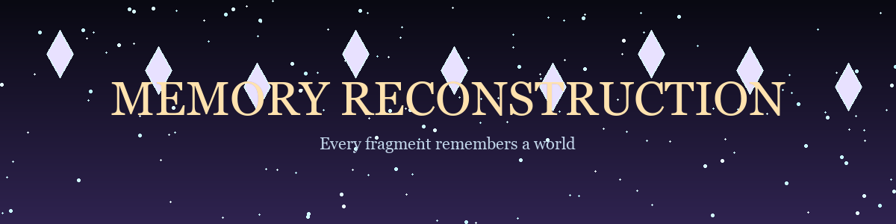

# Memory Reconstruction

**Action-Roguelike Metroidvania about rebuilding a fragmented world from lost memories.**



## ⚡ 30-Second Cold-Start Quick Reference

- **Runtime Prerequisites**: Node.js >= 18, npm >= 9
- **Canonical Regression Shield Gate**:
  ```bash
  npm test
  ```

### 🛠️ AIKit Commands (run from the AIKit folder)
| Role | Command |
|---|---|
| Status, task and gates | `python aikit.py status MemoryReconstruction` |
| Phase 4: every gate | `python aikit.py check MemoryReconstruction` |
| Repair memory and map, then check | `python aikit.py fix MemoryReconstruction` |
| Resume an interrupted task | `python aikit.py resume MemoryReconstruction` |

## 📦 What's Inside

```text
MemoryReconstruction/
├── .aikit/                   <- this project's memory: record, ledger, decisions
├── .gitattributes            <- LF normalization and binary asset rules
├── .gitignore                <- transient AIKit state excluded
├── .prettierrc
├── PROJECT_PRINCIPLES.md
├── README.md
├── assets/
├── docs/
├── eslint.config.js
├── index.html
├── LICENSE
├── package-lock.json
├── package.json
├── scripts/
├── src/
├── start.bat
├── start.sh
├── tests/
├── tsconfig.json
├── tsconfig.node.json
└── vite.config.ts
```

## Overview

Memory Reconstruction is a 2.5D action-roguelike metroidvania where you play as a **Memory Walker** - a being capable of navigating the fragmented remains of a shattered world. Each run explores procedurally generated biomes, combats memory-corrupted entities, and collects **Memory Fragments** to reconstruct the world's true history.

### Key Features

- **2.5D Graphics**: Hand-painted Memory Light sprites, biome tile atlases, parallax backdrops, dynamic lighting and post-processing
- **Adaptive Music**: Vertical layering system that responds to combat intensity
- **Memory Fragment Loop**: Collect glowing fragments, earn experience, level up, and unlock new abilities
- **Roguelike Runs**: Procedural worlds with meta-progression across runs
- **AI-Native Architecture**: Built for AI testing, RLM compatibility, and deterministic simulation
- **Modular Design**: Plugin architecture for easy extension

## Quick Start

```bash
# Zero-friction launcher
start.bat          # on Windows
./start.sh         # on Linux/macOS

# Or via npm
npm start          # or npm run dev

# Test
npm test

# Build
npm run build

# Regenerate the themed sprites, tilesets, UI and atlas metadata
python scripts/generate_art_assets.py
```

## Controls

| Action | Keyboard | Gamepad |
|--------|----------|---------|
| Move | WASD / Arrow Keys | Left Stick |
| Attack | Space / J | A / X |
| Dash | Shift / K | B / RB |
| Interact | E / L | Y |
| Pause | Escape | Start |

## Architecture

This project follows strict principles for **AI compatibility**, **modularity**, **RLM support**, and **testability**. See:

- [AI Agent Guide](docs/AI_AGENT_GUIDE.md) - For any AI working on this project
- [Architecture](docs/ARCHITECTURE.md) - System design and data flow
- [Contributing](docs/CONTRIBUTING.md) - Development workflow
- [Project Principles](PROJECT_PRINCIPLES.md) - Core philosophy

## Tech Stack

- **Language**: TypeScript (strict)
- **Rendering**: PixiJS v8 + WebGPU/WebGL
- **Audio**: Web Audio API
- **ECS**: Custom module system (ecsy-compatible)
- **Testing**: Vitest + custom deterministic harness
- **Config**: Zod-validated JSON
- **Shaders**: WGSL (WebGPU Shading Language)

## Game Design

### Genre
Action-Roguelike Metroidvania - High replayability, clear progression, exploration-focused

### Visual Style
Octopath Traveler-inspired: 2D hand-painted sprites with 3D normal-mapped lighting

### Story
**Theme**: Memory Reconstruction
**Delivery**: Environmental storytelling, minimal text
**Arc**: Discovery → Loss → Hope → Creation

### Music
Adaptive orchestral/ambient hybrid with vertical layering (intensity) and horizontal transitions

## Development

### Project Structure
```
src/
├── core/       # EventBus, ModuleRegistry, ConfigManager, GameApplication
├── engine/     # AssetManager, InputSystem
├── graphics/   # RenderSystem, ActorRenderer, atlases, HUD
├── audio/      # AudioSystem
├── gameplay/   # WorldSystem, PlayerSystem, CombatSystem, MemoryFragmentSystem
├── ai/         # AISystem (RLM, agents, observation)
├── testing/    # TestingHarness (scenarios, replay, benchmarks)
└── utils/      # Math, color, string, time helpers
```

### Adding Features

See [AI_AGENT_GUIDE.md](docs/AI_AGENT_GUIDE.md#adding-a-new-module) for patterns.

### Testing

```bash
# Run all scenarios
npm test

# Specific scenario
npm test -- --testNamePattern="basic_combat"

# Benchmark
npm run ai:benchmark

# Headless replay
npm run ai:replay -- --scenario=basic_combat --seed=12345
```

## RLM Compatibility

The game implements **Recursive Language Model** compatibility:

- Full state serializable to JSON (< 50k tokens)
- Deterministic simulation with seeded RNG
- Incremental state updates
- Token budgeting per module
- Headless mode for AI training/evaluation

```javascript
// In browser console
const state = window.__GAME__.serialize();
// Send to RLM context...

// Restore
await window.__GAME__.deserialize(state);
```

## License

AGPLv3 - see [LICENSE](LICENSE).

## Credits

- **Architecture**: Designed for AI-human collaboration
- **Art Style**: Inspired by Octopath Traveler, Hyper Light Drifter
- **Music System**: Inspired by Celeste, Hollow Knight adaptive audio
- **Roguelike Design**: Inspired by Dead Cells, Hades, Slay the Spire

---

*Built with ❤️ for AI and human developers alike*